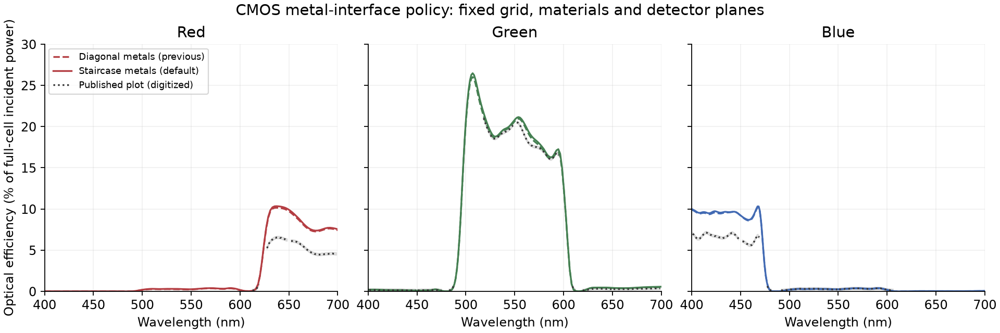

# CMOS discrepancy: controlled experiments on the RTX3090

This investigation fixes three demonstrated numerical issues while preserving
material coefficients, source polarization and physical detector positions.
It does not establish numerical agreement with the published Tidy3D sensor.
The original numerical Tidy3D output arrays are unavailable; approximate
6/20/6% values at 650/550/450 nm are readings of its published plot.
The published page links existing task
[`fdve-fd0bfa6c-17fc-4595-bcd5-57ae213cf8b9`](https://tidy3d.simulation.cloud/workbench?taskId=fdve-fd0bfa6c-17fc-4595-bcd5-57ae213cf8b9).
A read-only `web.get_info` attempt with its exact SDK version fails because
this machine has no configured Tidy3D API key. No new cloud job was submitted.

## Demonstrated fixes

### Integer-step monitor clock

The JAX loop previously used float32 `t += dt`, while source waveforms used
integer sample indices. Accumulation drift therefore detuned the monitor DFT
from the source. At the sensor's 35,385 steps, the final clock drift was
approximately +0.174 fs (0.728 rad at 450 nm). This final phase drift is not an
estimate of the flux error: the strongest fields occur much earlier.

The loop now computes `t_origin + dt * (step + 1)`. It preserves a supplied
nonzero origin and supports continuation, scan and fori-loop execution.
A 70,000-step constant-field test compares raw DFT accumulation with the exact
finite geometric sum, including split execution. The native CUDA multistep
loop already used an origin-based clock.

At eightfold depth refinement, maximum planar one-sided transmission errors
before/after the clock fix are 1.033/0.122 percentage points (red),
2.318/0.276 (green), and 3.501/0.398 (blue). At sixteenfold depth refinement,
blue reaches 0.098 points in transmission and 0.141 in reflection. This restores
convergence that was hidden by the timing defect.

### Native-field incident calibration

Tidy3D documents [one-watt plane-wave normalization at each frequency](https://docs.flexcompute.com/projects/tidy3d/en/latest/faq/docs/faq/How-are-results-normalized.html), with finite-grid caveats. The comparison therefore uses incident power over the full unit cell, not source spectral-envelope power.

The original empty-cell denominator used linearly colocated E and H in air
cells about 54.9 nm thick. This attenuates the measured plane-wave power and
inflates normalized device efficiencies. Two **native E planes**, separated
by two cells, now separate forward and backward waves in uniform-grid air:

`sin(k_fd h/2) = h sin(omega dt/2)/(c dt)`,

`E0 = A + B`, `E1 = A exp(-i k_fd L) + B exp(i k_fd L)`.

The forward power is `area * |A|²/(2 Z0)`. This specialized formula applies to
normal incidence in homogeneous air. It is not used to estimate power in the
patterned sensor. Synthetic bidirectional-wave tests independently check the
separation and reject cutoff or degenerate-plane configurations.

An empty normally incident reference needs no lateral refinement: transverse
derivatives vanish. A 4×4×430 reference reproduced the original 150×150×430
interpolated reference within 1.8e-7 before the clock change. The corrected
notebook retains the same physical aperture, z mesh, timestep, source and
acquisition time, and uses this smaller reference.

### One-sided detector reconstruction

Tangential H is continuous at the silicon boundary, but its derivative changes.
Interpolating between samples on opposite sides introduces a measurement error.
`FluxMonitor(colocation_side="plus" | "minus")` optionally uses three native H
samples on one side to reconstruct H at the **unchanged physical plane**.
Quadratic Lagrange weights use the actual nonuniform coordinates. E retains
its existing linear sampling. The default remains symmetric linear colocation.

This is a sampling option, not a constitutive correction. It currently supports
3D planes; the selected three samples must remain in a smooth medium. For this
sensor the plus-side stencil lies inside SiN. It should not be applied blindly
to the coarse smoke-test grid or across a second material interface. The
independent native-plane probe control checks the compiled implementation.

## Interface policy and historical runs

The original results below use diagonal smoothing for **all** materials.
The current default retains diagonal dielectric averaging and uses metal
staircasing. Reproduce the original component controls with
`--metal-smoothing inherit`; new default runs write separate `*-staircase-metal`
folders so the earlier evidence is preserved. The new comparison is in the
executed [diagnostic notebook](https://github.com/beamzorg/beamz/blob/t3code/add-cmos-rgb-notebook/examples/notebooks/cmos_cause_isolation.ipynb).
The main sensor notebook is re-executed with current metal staircasing and
periodic material supports. Historical all-diagonal numerical controls remain
in their original folders; the [parity follow-up](../cmos-parity-followup/README.md)
records the newer dielectric-response, ownership and lateral-grid comparisons.

## Metal-interface policy: controlled RTX3090 comparison

The new default changes only aluminum interfaces to staircasing and retains
causal diagonal averaging for every dielectric. At the source center frequency
588.878 THz, only material 5 (aluminum) satisfies Re(εr) < 1. Mesh, poles,
source, timestep, duration, incident calibration and detector positions are fixed.
The native rasterizer applies the same point ownership to ε∞ and all ADE terms;
terminal faces use the interior domain limit to avoid an artificial air seam.

| Policy | R, 650 nm | G, 550 nm | B, 450 nm |
| --- | ---: | ---: | ---: |
| Diagonal metals (previous) | 9.725% | 20.652% | 9.203% |
| Staircase metals (default) | 9.906% | 20.821% | 9.223% |
| Published plot (approximate) | 6.187% | 20.318% | 6.244% |

Central changes are **+0.181/+0.169/+0.020 percentage points** (R/G/B); maximum changes
anywhere in the spectra are 0.191/0.466/0.163 points. Residual central differences from
the digitized reference are **+3.719/+0.503/+2.979 points**, versus its conservative
±0.15-point image-reading allowance. This control tests the documented metal
policy difference; it does not establish full spatial convergence or identical
Tidy3D dielectric operators.

The 510 fs run completed in 606.9 seconds after setup on the
RTX3090, with finite fields and polarization. Maximum 300–510 fs change is
0.0152 percentage points. It uses one broadband device run for all
200 frequencies and reuses the configuration-matched empty reference.

[Raw run metadata](components/full-staircase-metal/report.json),
[source and input provenance](components/full-staircase-metal/source_manifest.json),
[comparison values](components/full-staircase-metal/metal_policy_comparison.json),
and [validation](components/full-staircase-metal/validation.json) accompany the
saved NPZ arrays. The implementation is commit `2632030e`.



Reproduce with:

```bash
XLA_PYTHON_CLIENT_PREALLOCATE=false OPENBLAS_NUM_THREADS=1 \
  .venv/bin/python scripts/validation/cmos_component_isolation.py \
  --stage full --metal-smoothing staircase
```

## Full sensor: separate each correction

All rows below use the same physical geometry and detector plane. Green sums
both green detector apertures. The clock-corrected row uses a newly computed
symmetric reference flux; the next row changes only its denominator; the final
row changes only detector H sampling.

| Configuration | Red, 650 nm | Green, 550 nm | Blue, 450 nm |
| --- | ---: | ---: | ---: |
| Historical reference z | 9.785% | 20.615% | 8.849% |
| Integer-step clock | 9.781% | 20.611% | 8.849% |
| + native incident calibration | 9.354% | 19.354% | 8.043% |
| + one-sided detector | **9.725%** | **20.652%** | **9.203%** |
| + optical-depth cap of 20 nm, fixed timestep | **9.898%** | **21.365%** | **9.807%** |
| Published Tidy3D plot, approximate | ~6% | ~20% | ~6% |

The timing defect is real but has little effect on this particular sensor's
central efficiencies. Its large final phase drift occurs mostly after the
strongest fields have decayed. Incident calibration and detector sampling
partly cancel; they do not explain away the reference discrepancy. Blue moves
farther from the published plot despite the independently validated corrections.
The full corrected run's maximum 300-to-510 fs changes are 0.0017/0.0146/0.0017
percentage points for R/G/B. More run time is unlikely to close this gap.

## Spatial convergence and component controls

The planar stack contains silica, one full-plane RGB filter, silica, SiN and
semi-infinite lossy silicon. The independent complex transfer matrix checks
both power and transmission phase. These planar controls retain paired
interpolated empty-plane flux normalization; their T errors include that
sampling error as well as propagation/interface error. The full sensor uses
the separate native incident calibration. Reflection and complex E transmission
provide additional checks beyond the flux denominator. Every subdivision retains all original z
edges. This test has no lenses or metal patterns and isolates longitudinal
optical discretization.

The native reference z grid remains too coarse for converged BeamZ planar
interference: maximum one-sided transmission errors are 6.438/13.601/17.879
percentage points for R/G/B. Fourfold subdivision reduces them to
0.523/1.045/1.565 points; eightfold gives 0.122/0.276/0.398. Thus the remaining
resolution issue includes the dielectric optical stack, not just metal depth
or transverse feature edges. Subdivision also reduces the timestep to satisfy
CFL; this sequence alone is not a pure space-versus-time separation.

At the central RGB wavelengths the coarse-stack transmission phase errors are
0.425/0.740/1.350 radians. These can affect interference and focusing even where
a scalar transmission happens to look reasonable.

These are errors against an analytical solution, not errors against Tidy3D.
The reconstructed reference z grid and the two solvers' distinct subpixel and
colocation operators are not an exact common-discretization comparison.

Component runs use patterned filters, then add the shield/interconnects, then
lenses. They share the 20 nm xy / reconstructed z grid, source, 510 fs duration,
200 frequencies, modal denominator and plus-side detector sampling. Removing
structures measures their effect within BeamZ; the published notebook does not expose the corresponding component curves,
so these BeamZ-only changes cannot by themselves attribute an inter-solver difference.

### Completed component and metal controls

| Same-grid component stage | Red, 650 nm | Green, 550 nm | Blue, 450 nm |
| --- | ---: | ---: | ---: |
| Patterned filters + dielectric stack | 10.463% | 19.123% | 6.912% |
| + aluminum shield/interconnects | 7.949% | 14.194% | 5.831% |
| + lenses (full sensor) | 9.725% | 20.652% | 9.203% |

Metal structures reduce central efficiencies in all channels; lenses recover
power into the apertures, especially in blue. This demonstrates sensitivity to
the structures, not that either structure is implemented incorrectly. All three
stages change by less than 0.015 percentage points from 300 to 510 fs.

The refreshed normal-incidence silicon interface sweep at 2.5 nm has maximum
transmission errors of 0.439/0.408/0.327 percentage points for interface shifts
0/0.25/0.5 cell with plus-side sampling. Symmetric sampling gives
1.750/1.436/0.327 points. At half-cell shift H is already sampled on the interface,
so there is no normal H interpolation to correct.

For the imported 100 nm aluminum film, broadband reflection error falls from
0.933 points at 5 nm to 0.250 at 2.5 nm. Transmission is tiny for this thick film;
its small absolute error is not a relative-transmission accuracy certificate.
The geometry-specific shielding/edge response still needs its own convergence
check. Raw spectra are in `metal-film`.

### Fixed-timestep depth and boundary controls

Capping optical-stack depth cells at 20 nm increases the full sensor from
150×150×430 to 150×150×519 cells while retaining the timestep, all original
edges, lateral mesh, silicon depth cells and external absorber/calibration
regions. Central R/G/B efficiencies become **9.898/21.365/9.807%**; maximum
spectral changes are **0.297/0.807/0.815 percentage points**. This moves all three
central values farther from the approximate published plot. The targeted
refinement demonstrates spatial sensitivity but neither establishes convergence
nor supports depth resolution as the sole explanation of the Tidy3D gap.

The same cap improves planar maximum transmission errors from
6.438/13.601/17.879 to 3.713/7.157/9.367 points. The full stack still requires
finer discretization, including the unchanged silicon region.

At fixed original planar mesh, reducing the timestep from 14.413 to 8.970 as
changes transmission by at most 0.342/0.509/0.650 points. Switching absorber to
CPML changes it by 0.180/0.040/0.019 points. These effects are much smaller than
the coarse planar-stack errors. This boundary control does not certify every
boundary effect in the patterned full sensor.

### Field-plot normalization

The updated notebook uses the public `get_dft_component` accessor before
normalizing intensity by physical incident power. Raw `dft_fields` contain
acquisition weights; mixing them with the new power denominator inflated plotted
intensity. A focused regression checks this conversion. This plotting defect
was caught while updating the notebook and does not explain the historical
optical-efficiency discrepancy. Complex physical field arrays and coordinates
are saved alongside the figures so that plotting changes need no device rerun.

## Reproduce

From the repository root, with the local CUDA-enabled environment:

```bash
export XLA_PYTHON_CLIENT_PREALLOCATE=false OPENBLAS_NUM_THREADS=1
.venv/bin/python scripts/validation/cmos_incident_calibration.py
.venv/bin/python scripts/validation/cmos_incident_calibration.py --boundary cpml
.venv/bin/python scripts/validation/cmos_flux_reconstruction.py
.venv/bin/python scripts/validation/cmos_stack_isolation.py --refinements 1 2 4 8
.venv/bin/python scripts/validation/cmos_stack_isolation.py --refinements 16 --channels blue
.venv/bin/python scripts/validation/cmos_stack_isolation.py --refinements 1 --boundary cpml
.venv/bin/python scripts/validation/cmos_metal_film_control.py
.venv/bin/python scripts/validation/cmos_component_isolation.py --metal-smoothing inherit --stage full
.venv/bin/python scripts/validation/cmos_component_isolation.py --metal-smoothing inherit --stage no_lenses
.venv/bin/python scripts/validation/cmos_component_isolation.py --metal-smoothing inherit --stage bare_stack
.venv/bin/python scripts/validation/cmos_component_isolation.py --stage full
.venv/bin/python scripts/validation/cmos_component_isolation.py --stage full --boundary cpml
.venv/bin/python scripts/validation/cmos_stack_isolation.py --refinements 1 --courant 0.35
.venv/bin/python scripts/validation/cmos_incident_calibration.py --optical-dz-nm 20
.venv/bin/python scripts/validation/cmos_stack_isolation.py --refinements 1 --optical-dz-nm 20
.venv/bin/python scripts/validation/cmos_component_isolation.py --metal-smoothing inherit --stage full --optical-dz-nm 20
.venv/bin/python scripts/validation/execute_cmos_notebook.py
```

Run the large GPU jobs sequentially and separately from host-memory-intensive
pytest/JAX compilation. The local machine has 24 GB GPU memory and 30 GB host
RAM. An overlapping test run exhausted host RAM and interrupted the first
sensor attempt; that attempt produced no accepted final data.

The executed `examples/notebooks/cmos_cause_isolation.ipynb` loads these saved
arrays and retains editable plotting code. `cmos_rgb_sensor.ipynb` executes the
full corrected sensor and empty reference and retains field-intensity plots.
The full sensor notebook executed seven code cells with zero errors. The
diagnostic notebook previously executed eight code cells, including the subsequent
[image/code/paper reconstruction](../cmos-reverse-engineering/README.md). The corrected full
notebook took 713.74 seconds on the RTX3090 and reproduced the independent
full-sensor spectra to within 8.1e-14 percentage points. Saved numerical arrays
are finite; `consistency_checks.json` records the comparisons and field maxima,
`provenance.json` records source hashes/environment, and `artifact_sha256.json`
checksums the accepted evidence. All hosted checks passed for implementation
commit `c67dea02`.

Historical outputs remain under `../cmos-polarized`; directories suffixed
`-accumulated-clock` preserve diagnostic runs before the clock correction.

## Validation and limits

The selected local suite passes **2,028 tests**, with one skip and one expected
failure. This adds 18 sampling tests, eight incident-wave calibration/mesh tests,
four long-run clock cases, one end-to-end calibration/origin test and one field-plot
normalization test to the previous 1,996-test selection. Ruff, Pyright,
Vulture and strict documentation checks pass. Tests were run in separate
process batches to bound JAX compilation-cache memory.

The broadband interface controls cover normal incidence. Existing oblique
constitutive checks at 550 nm do not certify broadband one-sided reconstruction
at arbitrary tilted interfaces. Full off-diagonal dispersive tensors,
separate Ohmic loss at polarized interfaces, custom CUDA/multi-device dispersion
and nonzero-phase Bloch boundaries remain outside the implementation.

Earlier 20-to-15 nm lateral refinement on the historical 5 nm depth grid changed
spectra by at most 0.11/0.28/0.05 percentage points. That uses the earlier
measurement pipeline and is not a current common-mesh test, but it also weakens
the claim that lateral resolution alone explains the gap.

The full sensor is not spatially converged and does not match the published
reference closely enough to claim parity. Original numerical Tidy3D fluxes/fields
are unavailable; further attribution uses the published code, digitized figures
and independent analytical controls. Independent lateral and full-depth
convergence must fit the available memory budget. Matched planar/component
outputs would improve attribution if they become available, but are not a
prerequisite for further investigation. The remaining lateral-grid and interface-operator differences are
candidates, not demonstrated causes of the inter-solver gap. Increasing
frequency sample count is not a replacement for this accuracy work.

The metal-policy extension executes nine code cells with no errors. Its new full-curve figure and rendered HTML were inspected. The final affected suite passes 829 Python tests plus 23 additional CMOS/plane-wave tests, and 53 Rust tests (one ignored).


## Full-sensor outer z boundary control

Changing only the outer z absorption changes central R/G/B by **−0.017/−0.009/+0.0003 percentage points**; maximum changes across the full spectra are **0.058/0.053/0.024 points**. These are much smaller than the remaining ~3.72/~2.98-point red/blue gaps. The full-sensor control therefore does not support the outer z absorbers as the dominant cause on this grid. All saved arrays are finite; the largest 300–510 fs change is 0.0354 points, so the smallest boundary differences should not be interpreted as precision measurements.

This leaves the discrepancy unresolved. Periodic seams, internal dielectric-interface operators, full spatial convergence and fidelity to the published reference remain separate attribution questions. Demonstrated planar discretization errors do not by themselves identify which of these explains the sensor mismatch.

The controlled RTX3090 run takes 566.31 seconds after setup on the same 150×150×430 grid, with unchanged timestep, geometry, material policy and detector reconstruction. R/G/B efficiencies with CPML are **9.889/20.812/9.224%**, versus absorber **9.906/20.821/9.223%**. Each uses its own native-wave incident calibration. Tidy3D itself uses adiabatic z absorbers, not CPML; this is a sensitivity test, not a replacement reference. Raw arrays, boundary specifications, source hashes, validation and the comparison plot are under `components/full-staircase-metal-cpml`. The analysis notebook executes ten code cells without errors.


## Periodic seams and independent dielectric checks

The seam correction changes central R/G/B by **−0.000072/+0.000042/−0.000050 percentage points**. Maximum changes over all 200 frequencies are **0.000630/0.000990/0.000326 points**, much smaller than the remaining **3.719/0.503/2.979-point** differences from the digitized plot. Late-time changes are up to 0.0153 points, so these tiny differences are not a claim of physical accuracy to six decimal places.

The periodic-material defect is fixed, but it does not explain this CMOS discrepancy on the tested grid. The independent dielectric power controls converge. They do not certify transmitted phase or arbitrary curved/high-contrast dispersive interfaces; full spatial convergence and the remaining reference mismatch are still open.

The [independent-check report](periodic-interfaces/README.md) includes tiled-domain comparisons, uniform/graded grids, static/dispersive materials, curved quadrature controls, oblique Fresnel checks of the imported silica/SiN models and rotated lossless-interface pulse tests. Flat seam discrepancies drop to float32 precision. At 5 nm the dispersive Fresnel power errors are below 0.069 pp; the 45° static-diagonal reflection error is 0.0065 pp. Raw sensor arrays are under `components/full-periodic-supports`. The diagnostic notebook executes 13 code cells without errors.
