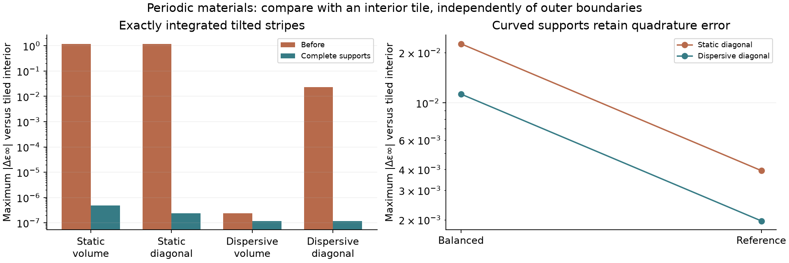
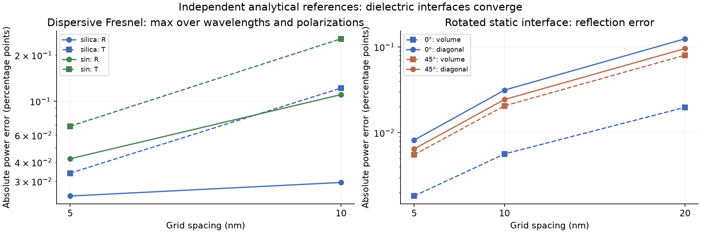

# Independent checks of periodic seams and dielectric interfaces

The tiled-domain comparison found a real periodic-material assembly defect.
The correction joins material fractions across the complete Yee support before
applying diagonal or volume averaging. Independent dielectric Fresnel controls
also converge. These findings do not establish the cause of the full CMOS
red/blue discrepancy; the fixed-grid sensor comparison is recorded separately.

## Periodic seams

A 16×16×4 periodic cell is compared with the center of an independently
rasterized 3×3 array of the same physical pattern. The initial fields repeat;
eight timesteps cannot carry disturbances from the reference's remote outer
seams into its central tile. Tilted dielectric stripes integrate exactly and
cross both periodic axes. Cases cover static and Lorentz media, uniform and
graded cells, and volume and diagonal averaging.

Two assembly errors were demonstrated:

- Legacy static voxel coefficients retained clipped half supports at the seam.
- Dispersive diagonal interfaces averaged already-smoothed half supports.
  Harmonic averaging is nonlinear: `H((f_left + f_right)/2)` is generally not
  `(H(f_left) + H(f_right))/2`.

The native raster now joins fractions with physical support-volume weights,
then applies one constitutive law. Static epsilon/conductivity, pole indicators
and harmonic-interface states use the same geometry. Duplicate faces use one
canonical metal point owner. Curvature gates use the full support instead of
an artificially narrower piece. Simulation boundary axes enter raster/cache
identity. The compiler also joins legacy static voxel coefficients.

All corrected flat and graded cases agree with the tiled reference within
**4.77e-7 in epsilon-infinity and 1.20e-7 V/m in electric fields**. The former
flat static-diagonal maximum coefficient difference was 1.196, and the
flat dispersive-diagonal difference was 0.0231.

Curved-cylinder controls retain adaptive quadrature differences. Maximum
static/dispersive diagonal coefficient differences decrease from
**0.02257/0.01128** at balanced quality to **0.00393/0.00197** at reference
quality. Reference-quality electric-field differences after eight steps are
below 5.1e-5 V/m. This is observed convergence, not a certified integration
error bound. The original curved discovery probe used 16×14×4 cells; it is
retained as historical evidence and is not used for a matched before/after
claim. The subsequent balanced/reference comparisons both use 16×16×4.



## Independent dielectric physics

The imported CMOS silica and silicon-nitride models are checked against
complex Fresnel admittances at 450 and 650 nm, 30° incidence, TE/TM polarization,
a quarter-cell interface offset, and 10/5 nm resolution. Each measured frequency
has one transverse wavelength in the periodic cell. The detector is four cells
inside homogeneous material; the analytical transmission includes propagation
loss to that plane. Matching empty-domain runs provide incident normalization.

| Maximum absolute error over both media, wavelengths and polarizations | 10 nm | 5 nm |
|---|---:|---:|
| Reflection | 0.1104 pp | 0.0421 pp |
| Transmission | 0.2557 pp | 0.0687 pp |

These errors include source and detector discretization. Not every individual
reflection error decreases monotonically; the aggregate maxima decrease and
all 5 nm cases meet the reported bounds.

A separate source-free TE pulse strikes a lossless n=1.5 dielectric normally,
with the physical interface rotated by 0° or 45° relative to the grid. The
frequency-independent analytical reflectance is 4%. A central transverse strip
is measured before radiation from distant boundaries can reach it. E/H are
colocated in space and time; an empty-domain pulse calibrates the denominator.
At 45°, the diagonal method's absolute reflection error falls from
**0.0956 → 0.0243 → 0.0065 pp** on **20 → 10 → 5 nm** grids. The axis-aligned
error similarly decreases from 0.1242 to 0.0082 pp. Volume averaging also
converges; these cases do not establish that diagonal averaging outperforms
volume averaging for every geometry or measurement.



The diagonal constitutive law remains an approximation to the full tensor.
These tests do not implement off-diagonal dispersive coupling or certify all
curved/high-contrast interfaces. They independently check the tested dielectric
response and separate it from periodic seam assembly.

## Reproduce

Run the GPU jobs sequentially from the repository root:

```bash
export XLA_PYTHON_CLIENT_PREALLOCATE=false OPENBLAS_NUM_THREADS=1
.venv/bin/python scripts/validation/periodic_material_seams.py --output docs/reviews/cmos-isolation/periodic-interfaces/flat-after.json
.venv/bin/python scripts/validation/periodic_material_seams.py --graded --output docs/reviews/cmos-isolation/periodic-interfaces/graded-after.json
.venv/bin/python scripts/validation/periodic_material_seams.py --geometry curved --output docs/reviews/cmos-isolation/periodic-interfaces/curved-after.json
.venv/bin/python scripts/validation/periodic_material_seams.py --geometry curved --quality reference --output docs/reviews/cmos-isolation/periodic-interfaces/curved-reference-after.json
.venv/bin/python scripts/validation/cmos_dielectric_fresnel.py
.venv/bin/python scripts/validation/rotated_dielectric_interface.py
.venv/bin/python scripts/validation/cmos_component_isolation.py --stage full --output docs/reviews/cmos-isolation/components/full-periodic-supports
```

The historical `*-before.json` arrays come from the pre-fix probes at commit
`898749c6`. Current controls use the numerical implementation in `bdc02402`.
The dielectric plots and assertions are executable cells in
`examples/notebooks/cmos_cause_isolation.ipynb`. The full sensor reuses the
existing empty-air calibration: the change leaves homogeneous-air coefficients,
source, mesh, timestep and duration unchanged.

These power checks do not bound transmitted phase error in the coarse sensor
mesh. The earlier planar-stack controls demonstrated substantial phase error;
that remains distinct from the periodic-material bug fixed here.


## Effect on the full CMOS sensor

The seam correction changes central R/G/B by **−0.000072/+0.000042/−0.000050 percentage points**. Maximum changes over all 200 frequencies are **0.000630/0.000990/0.000326 points**, much smaller than the remaining **3.719/0.503/2.979-point** differences from the digitized plot. Late-time changes are up to 0.0153 points, so these tiny differences are not a claim of physical accuracy to six decimal places.

The periodic-material defect is fixed, but it does not explain this CMOS discrepancy on the tested grid. The independent dielectric power controls converge. They do not certify transmitted phase or arbitrary curved/high-contrast dispersive interfaces; full spatial convergence and the remaining reference mismatch are still open.

The corrected R/G/B efficiencies are **9.905630/20.821064/9.223323%**. Raw arrays and the common-grid/normalization checks are in `../components/full-periodic-supports`.
