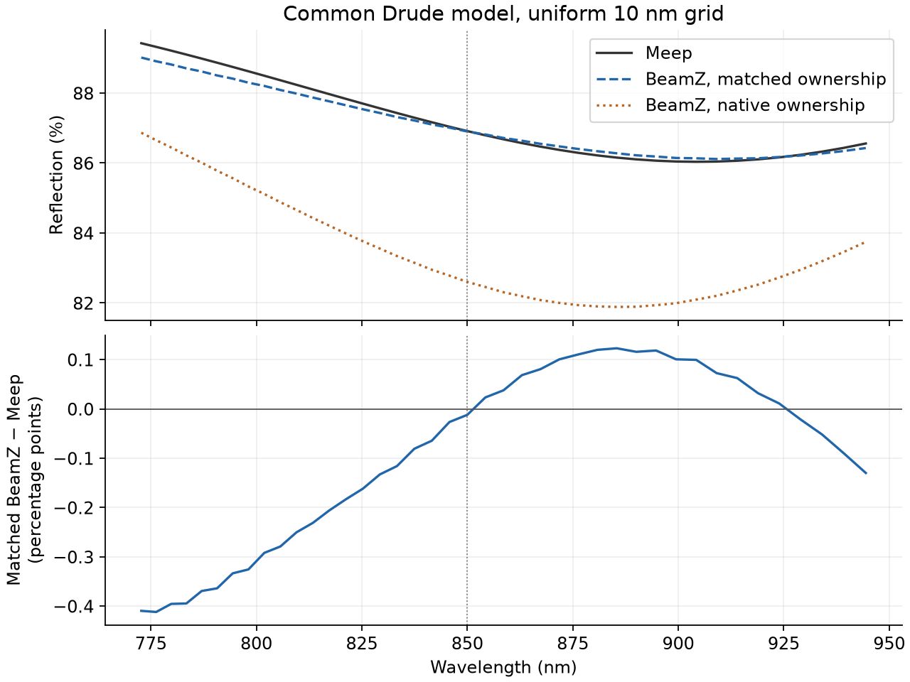
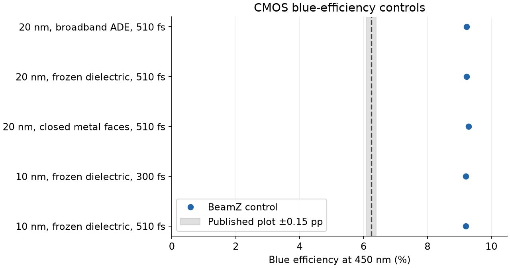

# CMOS parity follow-up

The target remains the published [Tidy3D CMOS notebook](https://www.flexcompute.com/tidy3d/examples/notebooks/CMOSRGBSensor/). Its plot values are digitized estimates, with a ±0.15 percentage-point reading allowance. No cloud simulations or hidden numerical task outputs are used. BeamZ simulations run on the local RTX3090; Meep is an independent CPU reference.

## Completed controls

### Dielectric averaging is too small an effect

The 150×150×430, 510 fs full-CMOS run changes only dielectric smoothing. Metal staircasing, geometry, source, mesh, timestep and incident-power calibration are held fixed.

| Central efficiency | Diagonal polarized averaging | Volume averaging | Published plot |
| --- | ---: | ---: | ---: |
| Red, 650 nm | 9.90563% | 9.90872% | ≈6.18655% |
| Green sum, 550 nm | 20.82106% | 20.81053% | ≈20.31832% |
| Blue, 450 nm | 9.22332% | 9.22356% | ≈6.24436% |

The largest change is 0.01054 points. Replacing the current diagonal dielectric averaging with volume averaging does not explain the gap. This does not test a complete anisotropic interface operator. The default remains diagonal polarized averaging for dielectrics and staircasing for metals.

### The dielectric ADE reproduces its frequency-domain response

At 450 nm, evaluate each dielectric's complex permittivity and the normal harmonic interface response at the trapezoidal ADE's warped frequency, `tan(pi*f*dt)/(pi*dt)`. Encode the positive-real response as epsilon and conductivity; retain the original metal poles and ownership. This diagnostic is equivalent at the measured frequency, not across the source bandwidth.

The resulting blue efficiency is **9.222521%**, versus **9.223323%** from the broadband ADE: a difference of **−0.000802 points**. The small comparison also includes interpolation of the broadband output and incident calibration. This rules out a large dielectric ADE response error at this operating point and permits a smaller-memory single-frequency mesh control. It does not replace the production broadband implementation or require a wavelength-by-wavelength production workflow.

The slab rasterizer uses one-cell halos and retains float32 coefficients. A whole-grid comparison at 200 nm lateral spacing, retaining all 430 reference depth cells and every CMOS material, verifies its coefficients and metal supports against the dense raster. The slab boundary locations cross dielectric and metal regions; this is a setup-equivalence check, not a coarse-grid physical-accuracy claim.

### Independent Meep resonator agreement after matching box ownership

A controlled 120×300×1600 nm periodic cell uses a 90×132.307692×30 nm gold antenna, a 50 nm dielectric spacer and a 130 nm gold film. Both solvers use a uniform 10 nm grid, the same timestep, all-interface staircasing, and 300 fs acquisition. A common Drude model matches the saved gold epsilon at 850 nm exactly. Its off-center spectrum is not the original multipole fit.

| Solver and effective geometry | Reflection at 850 nm |
| --- | ---: |
| Meep 1.34.0, CPU | 86.912922% |
| BeamZ, native half-open boxes, RTX3090 | 82.601288% |
| BeamZ, Meep's coefficient ownership, RTX3090 | 86.900845% |

The coefficient audit samples Meep at BeamZ's native Yee locations. Only Ex/Ey assignments on z=50 and 80 nm differ (372 Ex and 390 Ey sites in the audited optical region); Ez agrees. BeamZ excludes the upper faces of its half-open boxes, whereas Meep includes them. Matching those coefficients and pole supports reduces the reflection difference from **4.31163 points to 0.01208 points**. The model and geometry dimensions are unchanged. An independent CPU BeamZ run gives the same conclusion. Across all 41 frequencies of the common Drude test, the remaining reflection difference reaches **0.412 points** (RMS **0.204 points**); the 0.012-point agreement is specifically at 850 nm. Thus this control is not a broadband convergence certificate.

This identifies a concrete cause for the **uniform-grid common-model** discrepancy. It does not establish Tidy3D's proprietary server-side tie-breaking convention, nor retrospectively explain every graded-grid/original-fit comparison. Meep's separate 5 nm result is 86.340446%, demonstrating that its discretization also changes with resolution. The earlier Tidy3D plot estimate is ≈87.415%.

### Closed metal faces do not explain CMOS

At the original 20 nm lateral grid, closing metal box faces changes the frozen-response blue efficiency from **9.222521% to 9.284337%**, or **+0.061816 points**. Physical dimensions and all off-face ownership remain fixed. This moves away from the published ≈6.24436%. The maximum pixel-flux change from 300 to 510 fs is 0.000263 points. This tests a specific box-face convention, not every possible subpixel operator.



## Reference-mesh control

The remaining mesh check uses all **390×390×430** reconstructed Tidy3D cells, rather than only its depth mesh with 20 nm lateral cells. The single-frequency dielectric representation is validated above. Geometry, metal model, detector positions, z mesh, source, timestep and incident calibration remain fixed. Slab rasterization limits host-memory use; this is a diagnostic path, not a new production material model.

The first attempt rasterized successfully but exhausted host RAM while JAX embedded 2.53 GB of constants in HLO. Subsequent attempts use JAX 0.10.2's `jax_use_simplified_jaxpr_constants=True` to pass these constants separately, plus a local on-disk raster cache. This setting reproduces the smaller matched-ownership GPU result exactly. It changes compilation/memory handling, not material coefficients.

**The full reference-grid simulation did not complete.** Rasterization succeeded and GPU allocation reached about 16.8 GB, but host-memory guards stopped compilation at about 14 GiB process RSS with less than 1.5 GiB system RAM available. Aggressive glibc page release did not suffice. A stack trace identified JAX cache-key serialization as one peak; disabling the persistent compilation cache bypassed that stage but still reached the memory limit in `backend_compile_and_load`. Both traces and resource reports are retained in `frozen-450nm-dx20nm-reference-xy/`. No numerical result is inferred from successful rasterization or allocation. Further work must reduce host compilation memory to complete this exact-grid check.

The 10 nm lateral control is a smaller 300×300×430 grid, not the complete reconstructed mesh. Its completed uninterrupted 510 fs run gives **9.204162% blue efficiency**, versus **9.222521%** at 20 nm: **−0.018360 percentage points**. The 300 fs checkpoint differs by only **0.000117 points**. It completed in 683 seconds after setup, with a measured peak host RSS of 13.0 GiB. Halving the lateral spacing therefore barely changes the several-point discrepancy at this fixed depth mesh. The measured 20-to-10 nm change does not support lateral resolution as the sole explanation. The exact reconstructed grid remains untested numerically.



## Implementation and validation

The compact-grid path exposed a compiler defect: adding an absorber to direct Yee conductivity tried to interpolate a scalar cell conductivity as a multidimensional array. Compilation now broadcasts the scalar; regression tests compare zero and nonzero scalar summaries with expanded cell arrays. The original dense CMOS baseline did not trigger this defect, so the fix is not an explanation of its efficiency gap.

A coordinate-only test also omitted resolution for a metre-scale domain, accidentally requesting an optical-scale allocation. Giving that test its intended coarse resolution removes the excessive allocation without changing its coordinate assertions.

Local validation: **80 affected tests**, two documentation contracts, Ruff lint/format, Pyright, Vulture and strict documentation build pass. This is local evidence; it does not report hosted CI status for the new commit. The metal and cause-isolation notebooks execute 11 and 15 code cells without errors, and their rendered outputs were inspected. The main CMOS notebook was re-executed on the RTX3090 (seven code cells, no errors, 734.5 seconds including setup/calibration/plots); its full spectra reproduce the existing current-default control within 5.71e-8 percentage points. Its field maps now use current metal staircasing and periodic material supports.

## Reproduce

```bash
# The measured GPU environment contains CUDA JAX 0.10.2.
# For the full reference-grid attempt, also set MALLOC_ARENA_MAX=2
# and MALLOC_TRIM_THRESHOLD_=0 on glibc Linux. The final diagnostic also
# used JAX_ENABLE_COMPILATION_CACHE=false; compilation still hit the host limit.
XLA_PYTHON_CLIENT_PREALLOCATE=false OPENBLAS_NUM_THREADS=1 \
  .venv/bin/python scripts/validation/cmos_component_isolation.py \
  --stage full --smoothing volume --output docs/reviews/cmos-parity-followup/full-volume
XLA_PYTHON_CLIENT_PREALLOCATE=false OPENBLAS_NUM_THREADS=1 \
  .venv/bin/python scripts/validation/cmos_frequency_frozen.py
XLA_PYTHON_CLIENT_PREALLOCATE=false OPENBLAS_NUM_THREADS=1 \
  .venv/bin/python scripts/validation/cmos_frequency_frozen.py --reference-xy --single-pass --trim-host-allocator
XLA_PYTHON_CLIENT_PREALLOCATE=false OPENBLAS_NUM_THREADS=1 \
  .venv/bin/python scripts/validation/cmos_frequency_frozen.py --dx 10 --chunked --single-pass
XLA_PYTHON_CLIENT_PREALLOCATE=false OPENBLAS_NUM_THREADS=1 \
  .venv/bin/python scripts/validation/cmos_frequency_frozen.py --closed-metal-faces

# Separate CPU environment: conda-forge python=3.11 pymeep=1.34.0.
# Run this with that environment's Python:
python scripts/validation/meep_metal_crosscheck.py --dx 10
# Save both coefficient audits before the ownership-matched run:
JAX_PLATFORMS=cpu .venv/bin/python scripts/validation/beamz_meep_metal_crosscheck.py --dx 10 --coefficients-only
python scripts/validation/meep_metal_crosscheck.py --dx 10 --coefficients-only
XLA_PYTHON_CLIENT_PREALLOCATE=false OPENBLAS_NUM_THREADS=1 \
  .venv/bin/python scripts/validation/beamz_meep_metal_crosscheck.py --dx 10
XLA_PYTHON_CLIENT_PREALLOCATE=false OPENBLAS_NUM_THREADS=1 \
  .venv/bin/python scripts/validation/beamz_meep_metal_crosscheck.py --dx 10 --meep-ownership
.venv/bin/python scripts/validation/analyze_cmos_parity_followup.py
.venv/bin/python scripts/validation/execute_metal_notebook.py
```

The executed [metal benchmark notebook](https://github.com/beamzorg/beamz/blob/t3code/add-cmos-rgb-notebook/examples/notebooks/metal_solver_benchmarks.ipynb) presents the independent comparison alongside the earlier Mie, energy-balance and mesh-registration controls. The reports and spectra below this directory retain the actual measurements and execution settings.
