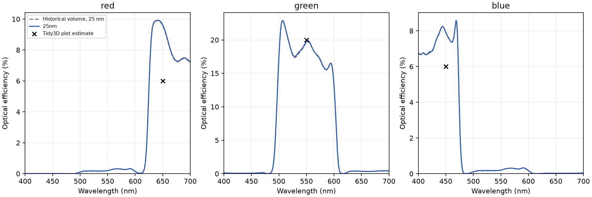

# Causal polarized dispersion: local validation

The default diagonal Farjadpour policy now applies to scalar dispersive media.
The complete causal normal response is harmonic and the tangential response is
arithmetic. The implementation retains constituent polarization histories at
native laminar interface supports; it does not harmonically average residues.
See the [update derivation](../../plans/dispersive-diagonal-update.md).

## Measured baseline

The local RTX3090 completed a 25 nm, 510 fs device/reference pair with 200
frequencies, exact imported material coefficients, and unchanged detector planes.
Fields and auxiliary polarization remained finite. Device execution, including
JIT compilation, took 214.5 seconds; the reference took 93.9 seconds. These are
local run times, not isolated performance benchmarks.

| Treatment | Red, 650 nm | Green, 550 nm | Blue, 450 nm |
| --- | ---: | ---: | ---: |
| Previous volume baseline | 9.565% | 19.642% | 7.888% |
| Causal diagonal, 25 nm | 9.616% | 19.740% | 7.909% |
| Published Tidy3D plot, approximate | 6% | 20% | 6% |

The maximum spectral changes from the previous baseline are 0.057, 0.182 and
0.056 percentage points for R/G/B. This change alone does **not** close the
reference disagreement. The historical uniform volume baseline also reconstructed
its instantaneous epsilon from cell averages; that inconsistency is now fixed,
so the historical comparison is not a pure constitutive-policy experiment.

Files in `25nm/` retain the raw device/reference spectra, calibrated efficiencies
and execution metadata. Wavelength arrays can be descending; sort before
interpolating central values. Green efficiency sums both green apertures, and all
channels use the same full-cell empty-reference incident power.

## Independent validation

Constitutive tests cover normal/tangential weights, fractions 0 and 1, identical
materials, static limits, shared epsilon-infinity, Lorentz and Drude responses,
and dispersive/dispersive mixtures. The expected response uses the trapezoidal
frequency mapping. Geometry tests cover equal-epsilon material identity;
continuation, periodic seams, memory estimates and immutable inputs are checked.

A 30-degree periodic oblique half-space fixture uses a transverse period of one
550 nm incident transverse wavelength, so no nonzero Bloch phase is required.
With CPML, preliminary CPU checks at 5 nm and a quarter-cell interface shift give
maximum reflection/transmission errors of 0.154/0.239 percentage points for the
polarized TE/TM cases. TE agrees with explicit volume averaging; TM improves on
its 0.318 percentage-point volume transmission error. GPU and position-refinement
results are recorded separately as they complete.

The ordinary absorber produced substantial feedback in that oblique fixture;
CPML is used to isolate its constitutive error. This is a boundary-control finding,
not evidence that changing interface averaging alone fixes a sensor simulation.

## Newly audited reference grid

The public snapshot's exact Tidy3D version, 2.12.0.dev3, reconstructs a
390 × 390 × 430 grid locally. No cloud job is submitted. Its 40 absorber cells
extend **outside** the specified physical domain: 2.19549 µm above and
0.465116 µm below it. The previous BeamZ setup used 400 nm absorbers inside the
physical box. The boundary position and thickness were therefore not matched.

`examples/data/cmos_rgb/tidy3d_reconstructed_grid.npz` stores the reconstructed
edges; the neighboring JSON records the version and snapshot hash. This is a
local reconstruction, not an exported server-result mesh. The control in
`examples/cmos_reference_mesh.py` retains its z edges and physical geometry,
including silicon through the lower absorber. Lateral spacing remains explicit
to fit the RTX3090. It is not a claim of common-mesh agreement.

## Limits

Original numerical Tidy3D output spectra remain unavailable. Reference output
values above are visual estimates from the [published notebook](https://www.flexcompute.com/tidy3d/examples/notebooks/CMOSRGBSensor/).
Its dielectric and metal interface policies differ (`PolarizedAveraging` and
`Staircasing`). The diagonal method omits off-diagonal tensor coupling and retains
native volume fallback at ambiguous normals. Monitor colocation at a material
jump, depth/time convergence, and sensor boundary sensitivity remain separate
accuracy gates; finite fields alone do not establish agreement.
