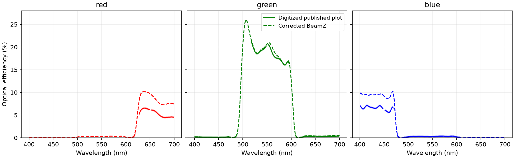
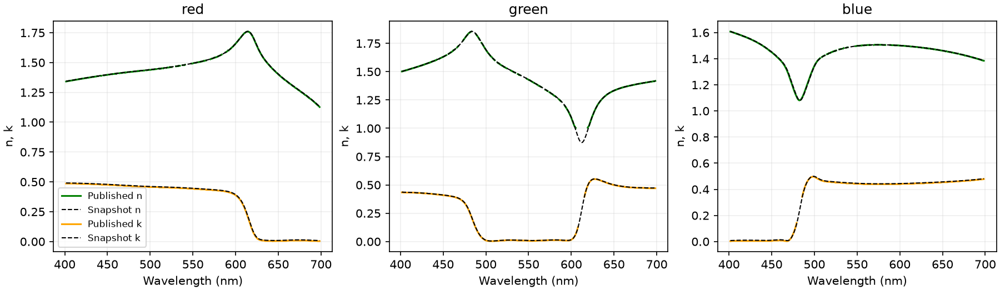
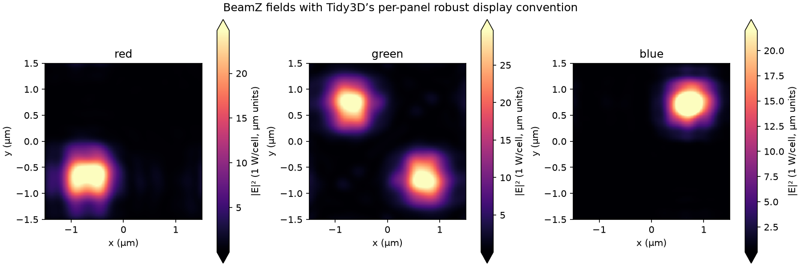

# Reverse-engineering the published CMOS reference

This follow-up uses the [published notebook](https://www.flexcompute.com/tidy3d/examples/notebooks/CMOSRGBSensor/), its embedded input, code, solver log and plot pixels. Numerical server results are not a prerequisite for this comparison. Recovered curves are approximate image measurements, not original simulation arrays.

## Plan and evidence

1. Digitize the complete efficiency curves, excluding dashed guides, clipped peaks and axis-overlapped samples. Retain the image and pixel calibration.
2. Independently compare the embedded RGB coefficients with the published fitted-index curves; use logged mesh dimensions and timestep to distinguish conflicting aluminum inputs.
3. Match the field-plot display conventions and audit the flux definition and subpixel settings from the exact-version SDK.
4. Test the aluminum ambiguity on the RTX3090 at fixed geometry, mesh, timestep, source and detector definitions, then compare the complete spectra. Keep the established physical model unless a controlled result supports changing it.

## Digitized efficiencies



| Central wavelength | Published image | Corrected BeamZ |
| --- | ---: | ---: |
| Red, 650 nm | 6.19% | 9.72% |
| Green, 550 nm | 20.32% | 20.65% |
| Blue, 450 nm | 6.24% | 9.20% |

Use a conservative **±0.15 percentage-point reading allowance**, not a statistical confidence interval. The original plot clips the green peak at 25%, so its peak height cannot be recovered. The digitizer leaves unavailable samples as NaN rather than inventing them.

For valid samples above 2.5% efficiency, median BeamZ/published ratios are 1.576 red, 1.012 green and 1.445 blue. Ratios vary across each band. Green's detailed spectral structure agrees closely; a single multiplicative normalization correction would spoil that agreement while still not matching both other bands. The figure is therefore substantially more informative than three rounded 6/20/6% values.

The published code negates the downward flux and sums the two green apertures. It applies no additional per-pixel or polarization averaging factor. Detector positions and 1.05×1.05 µm aperture sizes match the imported inputs. The four aperture areas are not the incident normalization area, which is the complete 3×3 µm cell.

## Filter fits and mesh fingerprint



The embedded filter models reproduce the independently plotted n/k curves to image precision: median absolute n discrepancies are about 0.001–0.002; median k discrepancies about 0.002–0.005. These are limited by axis/pixel calibration and line width. This supports the imported filter fits without relying solely on the embedded JSON's labels.

The public code selects `material_library["Al"]["Rakic1995"]`. In the snapshot's exact SDK version, 2.12.0.dev3, that selects five pole pairs, while the embedded viewer input has four real pairs and different optical constants. The other three library materials agree numerically.

| Offline reconstruction, exact SDK | Grid | Timestep |
| --- | --- | --- |
| Published solver log | 390×390×430 | 1.4413e-17 s |
| Embedded viewer snapshot | 390×390×430 | 1.44134656e-17 s |
| Replace only Al with code-library model; regenerate grid | 370×370×429 | 1.44184557e-17 s |

The logged grid strongly supports the embedded input as representative of the executed simulation. The code/library discrepancy is real, but it does not justify replacing the embedded metal merely because its name matches the code.

## Field-display and interface conventions



Tidy3D's exact-version `SimulationData.plot_field` defaults to `robust=True`: each panel gets its own 2nd–98th percentile limits. Published colorbar upper limits are therefore not field maxima. The saved BeamZ physical fields can be replotted with the same convention without another simulation. The figure uses 1 W over the complete unit cell and electric-field units based on micrometers; it does not infer unseen values in the saturated published pixels.

The exact-version `SubpixelSpec` documents dielectric `PolarizedAveraging` as a phenomenological contour-path approximation, and defaults metallic interfaces to `Staircasing`. It classifies a material as metallic when Re(epsilon) < 1 at the central frequency. These settings differ from BeamZ's causal diagonal averaging for all dispersive interfaces. The API description does not expose the complete proprietary numerical operator, so it cannot establish which solver has the physically more accurate coarse-grid result.

Sources for these conventions: [plot-field API](https://docs.flexcompute.com/projects/tidy3d/en/latest/api/_autosummary/tidy3d.SimulationData.html), [subpixel specification source](https://github.com/flexcompute/tidy3d/blob/develop/tidy3d/components/subpixel_spec.py), and the locally installed 2.12.0.dev3 SDK used for the reconstruction. Existing planar analytical controls remain the independent accuracy checks.

## Reproduce

```bash
MPLBACKEND=Agg .venv/bin/python scripts/validation/cmos_digitize_reference.py
# Use an environment containing tidy3d==2.12.0.dev3; offline, no API key needed:
python scripts/validation/cmos_reference_grid_fingerprint.py
XLA_PYTHON_CLIENT_PREALLOCATE=false OPENBLAS_NUM_THREADS=1 \
  .venv/bin/python scripts/validation/cmos_component_isolation.py --stage full --metal-model library --metal-smoothing inherit
```

The library-metal run uses the baseline 150×150×430 BeamZ control grid, rather than remeshing, to isolate the material substitution. Its raw results are stored separately in `../cmos-isolation/components/full-library-metal`.

## Paper-based interface audit

The user-provided Deinega–Valuev paper identifies a concrete limitation of the current diagonal constitutive approximation at curved dispersive-metal boundaries. [The detailed audit](paper-interface-audit.md) distinguishes diagonalizing ε from diagonalizing ε⁻¹, quantifies their difference for the imported aluminum, and defines the physical validation gates for a full-tensor implementation. This is a supported candidate, not a measured attribution of the full CMOS gap.

## Completed RTX3090 aluminum control

The fixed-grid library-metal run completed 35,385 steps (510 fs) with finite
fields and polarization. Its central R/G/B efficiencies are
**9.755/20.945/9.213%**, versus **9.725/20.652/9.203%** with the embedded metal.
The respective changes are +0.030/+0.292/+0.010 percentage points. This
substitution does not explain the red/blue discrepancy. The original snapshot
metal remains the default, supported also by the grid fingerprint.
