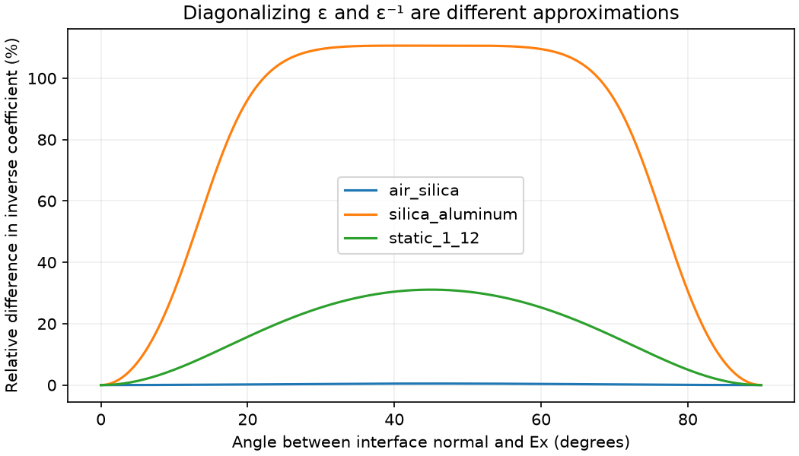

# Dispersive-interface audit against Deinega and Valuev (2007)

Reference: A. Deinega and I. Valuev, [Subpixel smoothing for conductive and dispersive media in the finite-difference time-domain method](https://doi.org/10.1364/OL.32.003429), Optics Letters 32, 3429–3431 (2007). All three pages, equations and figures were reviewed from the user-provided PDF.

## What the paper actually implements

Let `A(ω) = Σ f_j ε_j(ω)`, `H(ω) = 1/(Σ f_j/ε_j(ω))`, and `P = n nᵀ`. Equation (1) defines the full **inverse** effective tensor:

```text
β(ω) = ε_eff(ω)^−1 = P/H(ω) + (I − P)/A(ω).
```

Equations (3)–(6) split E into auxiliary fields. For two constituents, two branches use the original constituent permittivities, driven by the projected curl with weights `f` and `1−f`; the third uses the arithmetic mixture, driven by the tangential projected curl. Each branch may contain arbitrary Debye/Drude/Lorentz dispersion and can use ADE. The authors interpolate the cross-component terms between staggered locations.

The paper is not proposing a frequency-independent average of pole coefficients. It retains the frequency-dependent inverse response and interface orientation. Its Fig. 3 shows the benefit of tensor smoothing in the conductive-dielectric sphere test. More relevant to CMOS metal boundaries, Figs. 4–5 show that the diagonal approximation can perform badly for a negative-permittivity lead sphere, while the full tensor tracks Mie scattering substantially better. That is a benchmark result, not a universal stability guarantee for all interpolation schemes or materials.

## The distinction in our implementation

Our documented diagonal constitutive law is:

```text
ε_i(ω) = (1 − n_i²) A(ω) + n_i² H(ω)
β_i,current(ω) = 1/ε_i(ω).
```

This is the diagonal of the full **permittivity** tensor, followed by scalar inversion. Taking the diagonal of the paper's **inverse** tensor instead gives:

```text
β_i,inverse-diagonal(ω) = (1 − n_i²)/A(ω) + n_i²/H(ω).
```

These agree for pure normal/tangential components, identical constituents, and pure material cells. They generally differ for mixed cells at tilted interfaces. The complete tensor and its inverse are mutually consistent; **truncation and inversion do not commute**. Both scalar reductions are approximations, and neither implements the paper's full tensor. This is a model limitation, not proof that the present ADE incorrectly realizes its documented scalar law.

At a 50/50 silica/aluminum interface, 550 nm, and a 45° normal:

| Local quantity | Complex relative value |
| --- | --- |
| Current diagonal effective εx | −2.796 + 18.771i |
| Effective εx from inverse-diagonal truncation | 8.679 + 1.195i |
| Full inverse tensor βxy | 0.11967 + 0.00941i |

The inverse-update coefficients differ by about 111% relative to the inverse-diagonal value in this example. That is a **local constitutive comparison**, not a prediction of sensor efficiency error. For an air/silica mixture at the same angle and fraction, the corresponding difference is only about 0.49%.



The independent algebra check also verifies the full tensor's inverse and agreement of the diagonal approximations at the axis-aligned limits. Reproduce with `MPLBACKEND=Agg .venv/bin/python scripts/validation/cmos_interface_law_audit.py`.

### Code evidence

- `docs/plans/dispersive-diagonal-update.md` specifies the diagonal-ε law explicitly.
- `beamz/simulation/interface_dispersion.py` realizes its harmonic normal branch with constituent histories, combined with the tangential bulk ADE.
- `beamz/design/dispersive_interfaces.py` stores `normal_squared`, not the signed normal vector or products `n_i n_j`. It therefore cannot represent the required cross-component terms.
- The native rasterizer has a full static tensor path, but the dispersive path explicitly rejects `farjadpour_full`.
- `test_polarized_dispersion.py` verifies the implemented scalar response at fractional normal weights. That validates the chosen law, not equivalence to the full paper formulation. Axis-aligned planar analytical controls cannot expose the difference described above.

## What the Tidy3D documentation says

The exact snapshot SDK's [`SubpixelSpec`](https://github.com/flexcompute/tidy3d/blob/develop/tidy3d/components/subpixel_spec.py) defaults to dielectric `PolarizedAveraging` and metallic `Staircasing`. It classifies metals using Re(ε) < 1 at the central frequency. `PolarizedAveraging` is described as a phenomenological approximation to contour-path averaging and cites Mohammadi et al. (2005), the same reference numbered 5 in this paper. The API does **not** state that the default runs the full Deinega–Valuev dispersive tensor algorithm. A `SurfaceImpedance` setting for `LossyMetalMedium` does not mean it is used for this pole-residue aluminum.

Thus the paper supports concern about our curved-metal approximation, but it would be incorrect to say “Tidy3D implements this full tensor, therefore adding it guarantees agreement.” The historical BeamZ run used a different metal policy; the new default now uses metal staircasing. The circular aluminum aperture is particularly relevant because its normal rotates through x/y; flat, aligned layer interfaces do not exercise the omitted coupling.

## Next implementation gates

1. **Implemented at the user's request:** metal staircasing is the default, while dielectric diagonal averaging remains unchanged. `metal_smoothing="inherit"` retains the previous all-material policy. The controlled comparison holds materials, mesh, source and detectors fixed; see the [isolation report](../cmos-isolation/README.md).
2. Benchmark curved dispersive metal boundaries against Mie theory (sphere or infinite cylinder) at several resolutions and fractional grid offsets. Compare staircase, present diagonal-ε, inverse-diagonal, and full-tensor variants. Include a tilted dielectric interface separately.
3. For the full tensor, retain signed normals, implement cross-component projection/interpolation on the Yee grid, and add the auxiliary-field/ADE states from Eqs. (3)–(6). Validate static/axis-aligned limits, passivity/long-time stability, continuation, periodic seams and convergence before enabling it for CMOS.
4. Rerun the sensor only after those physical benchmarks identify which change improves accuracy. Compare against the digitized full curves and field morphology; do not optimize material coefficients against plot pixels.

The missing full dispersive tensor remains a literature-supported accuracy limitation of the optional diagonal-metal method. The controlled switch from diagonal metals to staircasing changes central CMOS R/G/B by **+0.181/+0.169/+0.020 percentage points**, yielding **9.906/20.821/9.223%**. This measures the metal-policy effect on this grid, not the error of a hypothetical full-tensor solver. Original Tidy3D output files would be convenient but are not required to carry out these gates.
